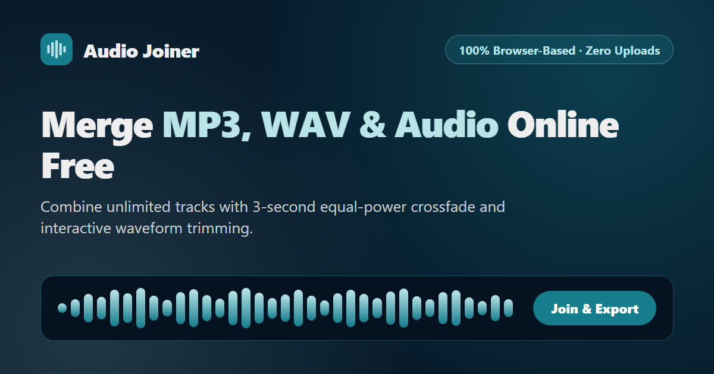
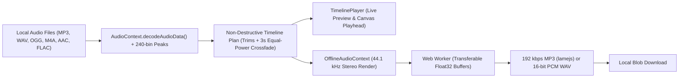

<div align="center">

<a href="https://audio-joiner.pages.dev/">
  
</a>

# Audio Joiner

**A privacy-first, 100% browser-based online audio joiner and MP3 merger built with Astro Islands, strict TypeScript, Tailwind CSS v4, and the Web Audio API.**

Merge unlimited MP3, WAV, OGG, M4A, AAC, and FLAC tracks into one seamless stereo file with interactive waveform trimming and 3-second equal-power crossfades — with **zero server uploads**.

<p>
  <a href="https://audio-joiner.pages.dev/"><strong>Live Application</strong></a> ·
  <a href="https://audio-joiner.pages.dev/how-to-use"><strong>How to Use</strong></a> ·
  <a href="https://audio-joiner.pages.dev/hire-me"><strong>Hire the Developer</strong></a> ·
  <a href="https://kisharadilshan.gumroad.com/coffee"><strong>Support Project</strong></a> ·
  <a href="https://github.com/Kishara007/audio-joiner/issues"><strong>Report an Issue</strong></a>
</p>

<p>
  <a href="https://audio-joiner.pages.dev/"></a>
  <a href="https://astro.build/"></a>
  <a href="https://www.typescriptlang.org/"></a>
  <a href="https://tailwindcss.com/"></a>
  <a href="https://pages.cloudflare.com/"></a>
  <a href="./LICENSE"></a>
</p>

</div>

---

## Table of Contents

- [Overview & Privacy Guarantee](#overview--privacy-guarantee)
- [Core Features](#core-features)
- [Audio Processing Pipeline](#audio-processing-pipeline)
- [Tech Stack](#tech-stack)
- [Project Structure](#project-structure)
- [Getting Started](#getting-started)
- [Deployment (Cloudflare Pages)](#deployment-cloudflare-pages)
- [Internationalization (8 Languages)](#internationalization-8-languages)
- [SEO, Accessibility & Performance](#seo-accessibility--performance)
- [Contributing](#contributing)
- [Author & Support](#author--support)
- [License](#license)

---

## Overview & Privacy Guarantee

Most online audio tools upload user recordings to remote backend servers for FFmpeg processing — introducing upload latency, file-size limits, privacy risks, and hosting costs.

**Audio Joiner** moves the entire audio pipeline into the user's browser:

| Capability | Traditional Server Tools | Audio Joiner (Client-Side) |
| --- | --- | --- |
| **File Privacy** | Uploaded to third-party servers | **100% local** — zero network transfers |
| **Upload Wait Time** | Scales with file size & bandwidth | **Instant** — local memory decoding |
| **Server Cost** | Requires compute & storage workers | **Zero backend cost** (static edge CDN) |
| **Track & Format Mixing** | Often restricted or watermarked | Unlimited tracks (MP3, WAV, OGG, M4A, AAC, FLAC) |
| **UI Responsiveness** | Blocks on server queue / polling | Dedicated **Web Worker** encoding at 60 FPS |

---

## Core Features

- **Zero-Server Web Audio Engine**
  - Local decoding via `AudioContext.decodeAudioData()` across mixed sample rates and channel counts.
  - High-precision offline mixing and resampling to **44.1 kHz stereo** using `OfflineAudioContext`.
- **Non-Blocking Web Worker Export**
  - Offloads CPU-intensive encoding to [`src/workers/audioExport.worker.ts`](./src/workers/audioExport.worker.ts) using zero-copy transferable `Float32Array` channel buffers.
  - Supports **192 kbps stereo MP3** (via `@breezystack/lamejs`) and **lossless 16-bit PCM WAV** with live percentage progress reporting.
- **Interactive HiDPI Waveform Studio**
  - Expandable `112px` `<canvas>` peak waveforms for the active track and compact `38px` strips for inactive tracks.
  - Pointer-capture drag handles (`Start` / `End`), keyboard slider support (`ArrowLeft` / `ArrowRight`, `Shift` for 1s steps), dimmed trimmed-out zones, and two-way synced precision `MM:SS.d` inputs.
- **3-Second Equal-Power Crossfade**
  - Per-track toggle applies an equal-power sine/cosine gain curve ($\sin(\frac{\pi}{2}u)$ / $\cos(\frac{\pi}{2}u)$) across overlapping adjacent tracks, safely clamped to 45% of clip length to prevent overlap collisions on short clips.
- **Live Merged Timeline Playback**
  - Real-time `AudioContext` preview scheduler reflecting exact trims and crossfades with a 60 FPS playhead sweep and click-to-seek on any waveform.
- **Minimalist Design System & Responsive UX**
  - Light-first palette (`#EEEEEE`, `#FFFFFF`, `#071B2B`, `#167D8D`, `#B9E4E8`) with persistent `localStorage` Dark Mode and inline FOUT prevention.
  - Desktop full-text navbar transitioning to a compact **icons-only mobile/tablet bar** (`44x44px` accessible touch targets), plus an in-app **Support Modal** with skeleton loading and Gumroad fallback.

---

## Audio Processing Pipeline



---

## Tech Stack

| Layer | Technology | Purpose |
| --- | --- | --- |
| **Framework** | [Astro 7](https://astro.build/) (`output: 'static'`, `format: 'file'`) | Zero-JS HTML pages with selectively hydrated React Islands |
| **Interactive UI** | [React 19](https://react.dev/) + [Lucide Icons](https://lucide.dev/) | Waveform studio, navbar, language selector, and support modal |
| **Language** | [TypeScript](https://www.typescriptlang.org/) (`strict` + `noUncheckedIndexedAccess`) | Compile-time safety across audio math, workers, and i18n keys |
| **Styling** | [Tailwind CSS v4](https://tailwindcss.com/) (`@tailwindcss/vite`) | Custom light/dark CSS tokens and reduced-motion-safe animations |
| **Audio Encoding** | Web Audio API + [`@breezystack/lamejs`](https://www.npmjs.com/package/@breezystack/lamejs) | In-browser decoding, crossfade mixing, MP3 & WAV export |
| **Hosting** | [Cloudflare Pages](https://pages.cloudflare.com/) | Edge static delivery with security `_headers` & `_redirects` |

---

## Project Structure

```text
audio-joiner/
├── public/
│   ├── _headers                    # Security headers, COOP modal support, immutable /_astro/* cache
│   ├── _redirects                  # Canonical & trailing-slash 301 normalization
│   ├── favicon.svg                 # Vector brand favicon
│   ├── og-image.png                # 1200x630 Open Graph / Twitter Card banner
│   └── robots.txt                  # Search engine directives & flat sitemap pointer
├── src/
│   ├── components/
│   │   ├── AudioJoinerTool.tsx     # Main focal workspace island (dropzone, stack, transport bar)
│   │   ├── CopyEmailButton.tsx     # Interactive mailto & copy-email control for /hire-me
│   │   ├── Footer.astro            # Semantic footer with modal support trigger
│   │   ├── Navbar.tsx              # Responsive desktop & 44x44px icons-only mobile navbar
│   │   ├── SupportModal.tsx        # Accessible Gumroad iframe dialog + in-modal fallback
│   │   └── TrackWaveformRow.tsx    # HiDPI waveform canvas, trim sliders, crossfade & track pill
│   ├── i18n/
│   │   ├── index.ts                # Locale registry, runtime DOM translator & storage helpers
│   │   └── {en,es,pt,de,fr,ja,zh,ru}.json  # 8 synchronized translation dictionaries (139 keys each)
│   ├── layouts/
│   │   └── BaseLayout.astro        # Meta tags, canonicals, JSON-LD, FOUT-free theme & GTM/GA4
│   ├── lib/
│   │   ├── audio/
│   │   │   ├── decode.ts           # AudioContext decoding & mono peak envelope generation
│   │   │   ├── export.ts           # Worker lifecycle & Blob download filename builder
│   │   │   ├── player.ts           # Real-time AudioContext playback & RAF timeline tracker
│   │   │   ├── render.ts           # OfflineAudioContext equal-power crossfade mixer
│   │   │   ├── timeline.ts         # Segment math, clamping & MM:SS.d parsing/formatting
│   │   │   └── types.ts            # AudioTrack, TimelineSegment & Worker message types
│   │   ├── theme.ts                # Light/Dark theme persistence & event dispatch
│   │   └── useLocale.ts            # SSR-safe React i18n subscription hook
│   ├── pages/
│   │   ├── hire-me.astro           # Freelance services page with BreadcrumbList JSON-LD
│   │   ├── how-to-use.astro        # Step-by-step usage & privacy guide with BreadcrumbList
│   │   ├── index.astro             # Hero workspace + Helpful Content sections & FAQPage schema
│   │   └── sitemap.xml.ts          # Flat XML sitemap endpoint for Google Search Console
│   ├── styles/
│   │   └── global.css              # Tailwind v4 setup, color variables & keyframe animations
│   └── workers/
│       └── audioExport.worker.ts   # Dedicated background MP3 (192 kbps) & WAV (16-bit) encoder
├── astro.config.mjs
├── package.json
├── tsconfig.json
├── LICENSE
└── README.md
```

---

## Getting Started

### Prerequisites

- **Node.js** `>= 22.23.4` (verified on `v24.x`)
- **npm** `>= 9.6.5`

### Installation & Local Development

```bash
# Clone the repository
git clone https://github.com/Kishara007/audio-joiner.git
cd audio-joiner

# Install dependencies
npm install

# Start the development server at http://localhost:4321
npm run dev
```

### Available Scripts

| Command | Description |
| --- | --- |
| `npm run dev` | Starts the Astro local development server with hot module replacement |
| `npm run typecheck` | Runs `astro check` and `tsc --noEmit` across all `.astro` and `.ts`/`.tsx` files |
| `npm run build` | Builds the static production site and bundled Web Worker into `dist/` |
| `npm run preview` | Serves the production `dist/` output locally for verification |

---

## Deployment (Cloudflare Pages)

Audio Joiner builds into pure static assets inside `dist/` (`output: 'static'`, `build.format: 'file'`).

### Option 1: Cloudflare Pages Git Integration

- **Framework preset**: `Astro`
- **Build command**: `npm run build`
- **Build output directory**: `dist`

### Option 2: Wrangler CLI

```bash
npm run typecheck
npm run build
npx wrangler pages deploy dist --project-name=audio-joiner
```

Included Cloudflare Pages configuration:
- [`public/_headers`](./public/_headers): Enforces `X-Content-Type-Options: nosniff`, `Referrer-Policy`, `Permissions-Policy`, `Cross-Origin-Opener-Policy: same-origin-allow-popups` (preserving compatibility with the in-app Gumroad support modal), and 1-year immutable caching on `/_astro/*`.
- [`public/_redirects`](./public/_redirects): Normalizes `/index.html` and trailing-slash subpage URLs to match canonical tags.

---

## Internationalization (8 Languages)

All UI labels, modals, subpages, and document metadata synchronize seamlessly without losing loaded tracks in the audio workspace. TypeScript enforces **100% key parity** (`139` keys per file) against [`src/i18n/en.json`](./src/i18n/en.json):

| Locale | Language | Dictionary |
| --- | --- | --- |
| `en` | English (Default) | [`src/i18n/en.json`](./src/i18n/en.json) |
| `es` | Español | [`src/i18n/es.json`](./src/i18n/es.json) |
| `pt` | Português | [`src/i18n/pt.json`](./src/i18n/pt.json) |
| `de` | Deutsch | [`src/i18n/de.json`](./src/i18n/de.json) |
| `fr` | Français | [`src/i18n/fr.json`](./src/i18n/fr.json) |
| `ja` | 日本語 | [`src/i18n/ja.json`](./src/i18n/ja.json) |
| `zh` | 简体中文 | [`src/i18n/zh.json`](./src/i18n/zh.json) |
| `ru` | Русский | [`src/i18n/ru.json`](./src/i18n/ru.json) |

---

## SEO, Accessibility & Performance

- **Structured Data**: Clean JSON-LD `SoftwareApplication` (no synthetic ratings) and `FAQPage` on `/`, plus `BreadcrumbList` exclusively on secondary pages (`/how-to-use`, `/hire-me`).
- **Search Discovery**: Flat [`/sitemap.xml`](./src/pages/sitemap.xml.ts) referenced directly in [`public/robots.txt`](./public/robots.txt), paired with canonical tags and Open Graph / Twitter Card metadata.
- **Accessibility**: Semantic landmarks, keyboard-operable trim sliders, dynamic `aria-label` / `aria-pressed` states, reduced-motion support (`prefers-reduced-motion`), and `44x44px` minimum touch targets on mobile/tablet navigation.

---

## Contributing

Contributions, bug reports, and translations are welcome:

1. Fork the repository and create a feature branch (`git checkout -b feat/your-feature`).
2. Make your changes and verify all 8 i18n dictionaries remain in sync if adding or updating UI copy.
3. Ensure strict verification passes with zero errors:
   ```bash
   npm run typecheck && npm run build
   ```
4. Open a pull request describing your changes clearly.

---

## Author & Support

Developed and maintained by **Kishara Dilshan**.

- **Website**: [https://audio-joiner.pages.dev/](https://audio-joiner.pages.dev/)
- **Freelance & Custom Projects**: [Hire Me](https://audio-joiner.pages.dev/hire-me) · [kisharadilshan007@gmail.com](mailto:kisharadilshan007@gmail.com)
- **Support Development**: [Buy Me a Coffee on Gumroad](https://kisharadilshan.gumroad.com/coffee)

---

## License

This project is open source and available under the [MIT License](./LICENSE) — Copyright © 2026 Kishara Dilshan.
